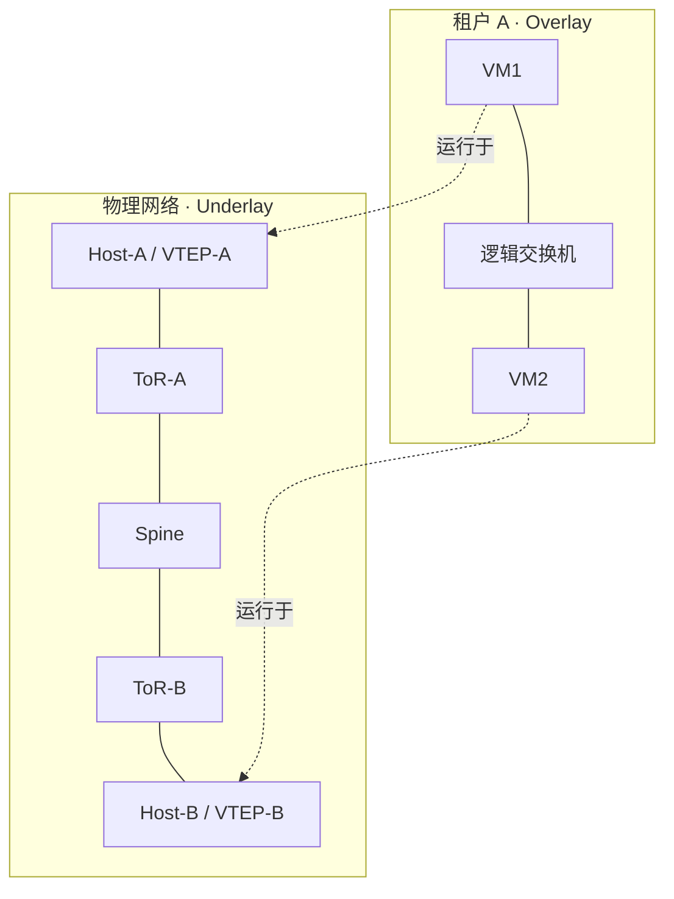
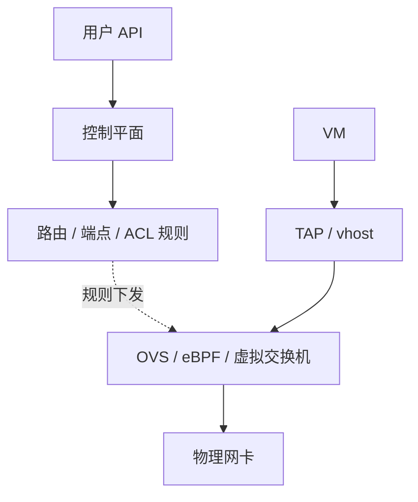

> 本文围绕可验证的网络机制与工程实现展开。文中地址为教学示例，具体云产品行为应以官方文档和实际配置为准。

## 1. 问题背景：物理网络为何难以直接承载云计算

传统数据中心通常以机架、交换机、VLAN 和静态地址规划组织网络。业务系统部署周期较长，网络拓扑相对稳定，网络团队可以手动分配网段、配置交换机端口和调整路由。虚拟化改变了这些假设：一台宿主机上可运行数十台虚拟机，虚拟机可能被频繁创建、销毁或迁移，不同租户还可能使用完全相同的私网地址。

如果继续让每个租户直接占用物理 VLAN，会遇到三个问题。首先，VLAN ID 只有 12 位，不能无限扩展；其次，租户网络拓扑与物理位置耦合，迁移虚拟机可能牵涉物理网络配置；最后，手工操作难以跟上云平台的资源生命周期。

因此，云网络的目标不只是“让虚拟机能通信”，而是让网络像计算资源一样可以按 API 声明、创建、隔离和回收。

## 2. 两层网络：Underlay 与 Overlay



**Underlay** 是承载宿主机之间通信的物理 IP 网络，负责将报文送到目标宿主机；**Overlay** 是建立在其上的租户逻辑网络，借助 VXLAN、Geneve 等封装把租户二层帧跨三层传送。租户可以看到自己的子网、网关和 MAC 地址，而 Underlay 路由器只需知道宿主机的地址。

以 VXLAN 为例，原始租户以太网帧成为内层载荷，外层 UDP/IP 以源、目的 VTEP 地址标识宿主机。VNI 用于标识逻辑网络。VXLAN 的典型 UDP 目的端口为 4789；具体产品也可能采用其他封装或硬件卸载方式。

## 3. 控制平面与数据平面的分离

云控制平面负责管理租户网络、分配地址、记录虚拟机所在宿主机、计算路由和下发安全策略。数据平面负责按已有规则逐包处理，包括查表、过滤、封装、转发和统计。



当 VM 从 Host-A 迁移到 Host-B 时，控制平面需要更新端点位置；如果数据平面仍保留旧映射，报文可能继续被封装到 Host-A。这解释了为什么云网络故障排查必须同时关注**逻辑配置**和**实际生效的转发表**。

## 4. Linux 与开源项目中的实现

Linux 的 network namespace 提供网络栈隔离，VRF 提供路由域隔离，Bridge/OVS 提供二层转发，VXLAN 设备提供隧道封装。它们是构建云网络的积木，而非某个组件单独等同于 VPC。

```bash
ip netns list
ip -d link show
bridge fdb show
ip rule show
```

OpenStack Neutron 通过网络、子网、路由器等对象管理租户网络，常与 Open vSwitch、OVN 或 Linux 网络组件配合。OVN 将逻辑交换机和逻辑路由器编译为各宿主机可执行的转发规则。公有云厂商也采用软件转发、硬件卸载和专用网络设备的不同组合，公开的产品抽象不必然暴露内部具体实现。

## 5. 工程取舍与排障思路

Overlay 提高了租户网络的独立性，却引入封装头、MTU、端点同步和额外的观测难度。设计时应分别确认逻辑网络 MTU、物理网卡 MTU 和隧道开销。排障时按“VM 路由 → 虚拟交换机 → VTEP → Underlay → 远端 VTEP → 目标 VM”逐层定位，而不是只检查两端的 `ping`。

## 参考资料
- [RFC 7348 — Virtual eXtensible Local Area Network (VXLAN)](https://www.rfc-editor.org/rfc/rfc7348)
- [Linux kernel — VRF](https://docs.kernel.org/networking/vrf.html)
- [Open vSwitch Documentation](https://docs.openvswitch.org/en/latest/)
- [OpenStack Neutron](https://docs.openstack.org/neutron/latest/)

---

[下一篇：VPC 的本质：逻辑隔离、地址空间与数据平面 →]({{ '/lessons/02-vpc/' | relative_url }})

[返回全部文章]({{ '/lessons/' | relative_url }})
