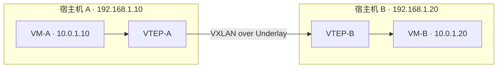

## 1. 同子网通信为何需要跨物理网络

设 VM-A 为 `10.0.1.10/24`，位于 Host-A（`192.168.1.10`）；VM-B 为 `10.0.1.20/24`，位于 Host-B（`192.168.1.20`）。两台 VM 在逻辑上属于同一二层子网，但宿主机之间可能隔着多台三层交换机。



VM-A 查找路由后认为目的地址“直连”，因此会尝试解析 VM-B 的 MAC，而不是把报文发送到默认网关。ARP 请求可能被宿主机转发、代理应答，或由控制平面提供的端点信息处理。

## 2. 报文封装的逐跳变化

VM-A 发出的内层帧大致如下：

```text
Inner Ethernet: VM-A-MAC → VM-B-MAC
Inner IP:       10.0.1.10 → 10.0.1.20
```

Host-A 的 VTEP 根据目标 MAC/IP 与端点表查出 VM-B 位于 Host-B，并进行 VXLAN 封装：

```text
Outer Ethernet: Host-A next-hop MAC → ...
Outer IP:       192.168.1.10 → 192.168.1.20
Outer UDP:      dst port 4789
VXLAN:          VNI 1001
Inner Ethernet: VM-A-MAC → VM-B-MAC
Inner IP:       10.0.1.10 → 10.0.1.20
```

Underlay 路由器只处理外层 IP；Host-B 收到后解封装，将原始二层帧交给 VM-B。中间三层设备无需维护每台租户 VM 的私网路由。

## 3. MAC、ARP 与端点位置从哪里来

经典 VXLAN 可以通过数据平面学习远端 MAC；大规模云网络则常使用控制平面下发端点位置，避免大范围泛洪。EVPN 提供了基于 BGP 分发 MAC/IP 可达信息的标准化方案；OVN 通过逻辑端口与流表实现类似的端点寻址目标，但控制协议和实现路径不同。

虚拟机迁移时，必须更新 MAC/IP 到 VTEP 的映射；若远端仍指向旧宿主机，就可能出现短时黑洞或绕行。

## 4. MTU 的隐性代价

在常见 IPv4 VXLAN 场景下，外层 Ethernet、IPv4、UDP 和 VXLAN 合计约增加 50 字节（具体取决于 VLAN、IPv6 和可选头）。如果 Underlay 只有 1500 MTU，却允许租户发出完整 1500 字节的内层 IP 包，就可能遇到分片、PMTU 问题或丢包。

```bash
ip -d link show
bridge fdb show
tcpdump -ni eth0 'udp port 4789'
tracepath 10.0.1.20
```

## 5. 工业实现

Linux 原生 VXLAN 设备与 Linux Bridge 可以构建简易实验；Open vSwitch 能把隧道端口、MAC 查找和流表策略结合；OVN 负责在逻辑网络和宿主机数据平面之间分发规则。部分云平台利用智能网卡或硬件卸载减轻宿主机 CPU 负担，但不能假设所有云平台均使用 VXLAN。

## 6. 排障经验

先在 VM-A 确认路由和邻居表，再观察 Host-A 的端点映射与封装流量；在 Host-B 验证是否收到外层 UDP、能否解封装以及内层帧是否到达 VM-B。只在 VM 内抓包，无法区分“未封装”“Underlay 丢包”和“远端解封装失败”。

## 参考资料
- [RFC 7348 — VXLAN](https://www.rfc-editor.org/rfc/rfc7348)
- [RFC 7432 — BGP MPLS-Based Ethernet VPN](https://www.rfc-editor.org/rfc/rfc7432)
- [Linux kernel — VXLAN](https://docs.kernel.org/networking/vxlan.html)
- [Open vSwitch Documentation](https://docs.openvswitch.org/en/latest/)

---

[← 上一篇：VPC 的本质：逻辑隔离、地址空间与数据平面]({{ '/lessons/02-vpc/' | relative_url }}) · [下一篇：分布式网关：VPC 跨子网流量如何转发 →]({{ '/lessons/04-distributed-routing/' | relative_url }})

[返回全部文章]({{ '/lessons/' | relative_url }})
